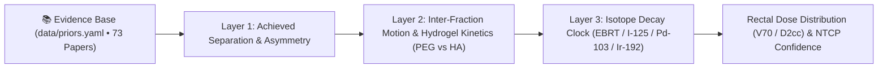

<div align="center">

# spacer-mc 🎯🔬

**Monte Carlo Uncertainty Propagation for Hydrogel Rectal-Spacer Dose Sparing in Prostate Radiotherapy**  
*Sourced 73-paper evidence base, random-effects meta-analytic pooling, and uncertainty propagation across EBRT, LDR, and HDR brachytherapy*

[](https://github.com/callmesobhan/spacer-mc/actions/workflows/ci.yml)
[](LICENSE)
[](pyproject.toml)
[](#the-question)

</div>

> [!WARNING]
> **Research and teaching code. Not for clinical use.** Nothing here has been validated for treatment decisions.

## Model Layers & Architecture



## Status: v0.2 — 4D Resorption x Isotope-Decay Decision Engine

Commercial treatment-planning systems (Eclipse, RayStation, VariSeed, Oncentra Brachy) evaluate post-injection hydrogel spacer geometry as **frozen in time**. `spacer-mc` propagates coupled **4D hydrogel resorption kinetics (PEG vs HA vs DuraSeal vs Balloon) x brachytherapy isotope decay clocks (I-125 vs Pd-103 vs Cs-131 vs Ir-192) x post-implant oedema decay x heavy-tailed daily rectal motion** to quantify the **Hidden Resorption Penalty** and solve the inverse clinical problem: *what minimum post-injection separation is required for 95% confidence of meeting a rectal constraint?*

What this repository ships:

1. **Sourced evidence base** ([data/priors.yaml](data/priors.yaml), 73 papers in [refs/references.bib](refs/references.bib)): 92 evidence rows tied to DOIs and checked by provenance level (`table`/`text`/`abstract`).
2. **4D Monte Carlo & TG-43 / EBRT engine** (`src/spacer_mc`):
   - `kinetics.py`: 3-phase PEG kinetics (Mariados 2015, Uhl 2014, Kubo 2021), early-drop + plateau HA kinetics (Björeland 2023), DuraSeal rapid separation decay (Vaggers 2021), LDR prostate oedema resolution (Haddad 2023), and exact radioactive decay quadrature (King 2021).
   - `geometry.py`: 3-D anterior-posterior rectal volume mesh with per-level `(apex, mid, base)` spacer profiles (Pinkawa 2013, Prusty 2025), lateral taper (Hwang 2018), apex-failure tail (Ben-Dor 2025), and heavy-tailed Student-*t* daily motion (Polizzi 2024).
   - `dose.py` & `radbio.py`: calibrated dual-component EBRT gradient (Susil 2010 / Whalley 2016), 3-D AAPM TG-43 seed/dwell superposition (`I-125`, `Pd-103`, `Cs-131`, `Ir-192`), DVH metrics (`V70`, `D2cc`, `D1cc`, `V75`), EQD2, and LKB NTCP (checked against Wong 2025).
   - `decision.py` & `cli.py`: paired no-spacer vs static-TPS vs 4D-delivered Monte Carlo (`simulate_4d`), inverse 95%-confidence required-separation maps (`solve_required_separation`), and the cross-regime/material clock comparison matrix (`compare_clock_matrix`).

### Quickstart (CLI & Python)

```bash
pip install -e ".[dev]"

# Compare hidden 4D resorption penalties across EBRT, SBRT, I-125, Pd-103, Cs-131, HDR and PEG/HA/DuraSeal
spacer-mc compare-clocks

# Patient-specific 4D risk check from post-injection apex / mid / base thickness (mm)
spacer-mc simulate --regime ldr_i125 --material PEG --apex 8 --mid 10 --base 12

# Inverse clinical question: static TPS vs true 4D required separation for 95% confidence
spacer-mc required-separation --regime ldr_i125 --material PEG --confidence 0.95

# Verify calibrated 4D physics against 7 published literature benchmarks
spacer-mc validate
```

## The question

A rectal spacer is judged on one scan taken after injection. Delivered rectal dose also depends on how much separation was actually achieved and where, how the rectum moves from day to day, how the spacer changes over the treatment course, and, for brachytherapy, how source decay interacts with spacer lifetime. This project asks: for a given regime and spacer material, what is the *distribution* of rectal dose with and without a spacer, and what achieved separation gives 95% confidence of meeting a rectal constraint?

## Limitations, stated first

- **Built only from published aggregate data.** No patient data, no dose grids, no treatment plans. Models are calibrated to reported averages and tested on held-out studies; aggregates lose patient-level correlation.
- **16 papers the project relies on are still second-hand or abstract-only** ([docs/PAPERS_NEEDED.md](docs/PAPERS_NEEDED.md)). Rows that depend on them are not marked verified, and none is blocking.
- **Published reviews can mix metrics.** One widely cited meta-analysis pools a brachytherapy value with external-beam V70 values; this repo checks that rather than inheriting it (see the evidence table).
- **Paired before/after plans are re-optimised**, so they mix geometry with planner behaviour. The model keeps these as separate terms.
- **Funding and conflicts:** the pivotal-trial papers report funding from the device maker. Weigh them accordingly.

## What the evidence base shows so far

All of these are recorded with their sources and check level in `data/priors.yaml`.

- **PEG spacer time course.** Separation is stable through an 8-week course, falls steeply around months 3 to 5, and is gone on MRI by 6 to 12 months (Mariados 2015, Uhl 2014, Pinkawa 2013). The onset varies between patients (Kubo 2021).
- **HA spacers behave differently.** Thickness fell 28 to 32% within the first month and then plateaued, roughly halving the dose benefit (Björeland 2023).
- **Isotope clocks differ.** By decay alone a 3-month spacer covers about 65% of an I-125 implant's dose but about 97% of Pd-103 (half-lives from King 2021).
- **Dose against separation.** With the rectum shifted away from a fixed IMRT dose cloud, mean rectal V70 was 23.0%, 15.1%, 3.7% and 0.0% at 0, 5, 10 and 15 mm (Susil 2010).
- **Thickness predicts dose; symmetry does not.** A per-location thickness score tracked rectal dose at every level in 822 patients, while a symmetry category did not (Prusty 2025).
- **A pooled V70 heterogeneity of 97% was mostly one HDR study** (Miller 2020). Without it, five external-beam studies give I² of about 50%.

## Layout

```
DESIGN.md              the design, validation plan, milestones and risks
data/priors.yaml       evidence table: 92 rows, each citing a paper
refs/references.bib    73 papers with DOIs (metadata from Crossref)
docs/SOURCES.md        every source, what it is used for, how deeply it was read
docs/PAPERS_NEEDED.md  papers still needed, with full citations
src/spacer_mc/         dose.py, sampling.py (1-D spike), calibrate.py (random-effects pooling)
tests/                 closed-form benchmark, meta-analysis reproduction, evidence-table integrity
```

## How evidence is checked

Every row in `data/priors.yaml` carries a `checked` level:

| Level | Meaning |
|---|---|
| `table` | read from a table or figure of the paper (rendered and read, because text extraction scrambles tables) |
| `text` | read in the paper's body text |
| `text_match` | the number appears in the full text but its context was not read |
| `abstract` | taken from an abstract only |

`verified: true` is only allowed for `table` or `text`. Rows taken from a review's compilation are flagged `secondary`. A test enforces this, and every row must cite a key in the bibliography. Current counts: **68 of 92 rows verified** (26 table, 42 text), 6 string-matched, 16 abstract-only, 2 derived here and labelled.

## Run the tests

```bash
python -m venv .venv && source .venv/bin/activate
pip install -e ".[dev]"
pytest
```

## Roadmap

See [DESIGN.md](DESIGN.md) section 11. In short: EBRT calibration (M2), then LDR with a time dimension (M3, M4), sensitivity and required-separation curves (M5), then HDR (M6), then hardening (M7). Protons are out of scope. The repository will be updated as the outstanding papers arrive.

## Sources and licensing

The papers themselves are **not** in this repository and are not redistributed. The repo holds extracted numbers with citations, so each can be traced to its source by DOI. Check the licence of any paper before reusing a figure from it. The code and original text are MIT licensed ([LICENSE](LICENSE)).
